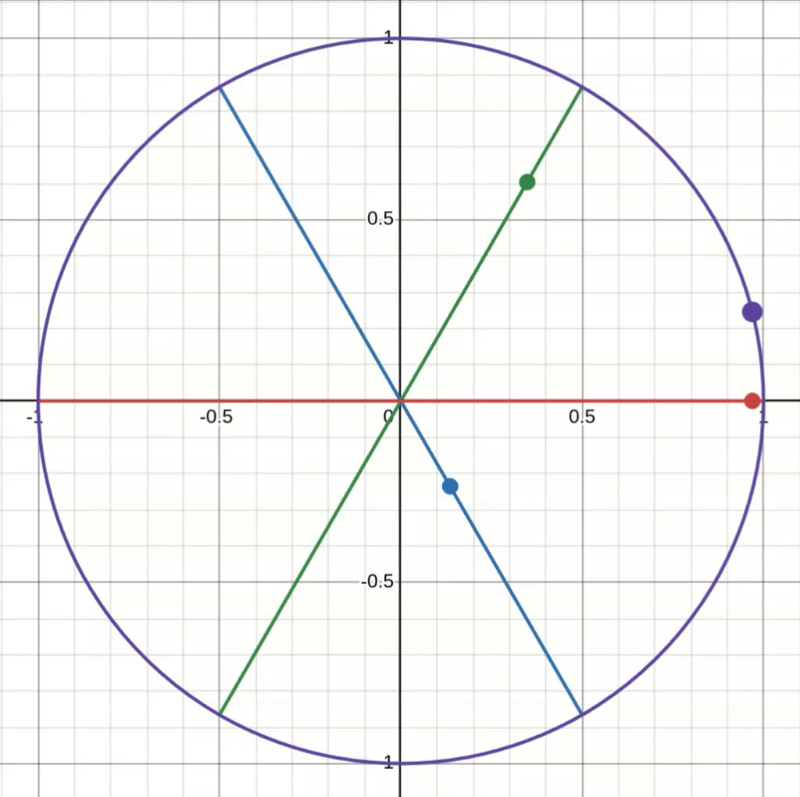

# Algorithms
There are a few main algorithms used in this code. The brushless motor is controlled using Field-Oriented Control (FOC), cos and sin values for an angle are calculated using CORDIC, and a simple algorithm is used to calculate the PWM for the gate drivers.

## Field-Oriented Control
### Brushless DC Motor Basics
A brushless motor (BLDC) has an internal magnetized rotor and an three sets of outer coils. For the motor to spin, the three sets of coils need to be turned on and off depending on the rotor angle and push or pull the rotor in the desired direction. The BLDC motor has 3 inputs corresponding to the three coil sets and works very similarly to a three phase power load. 

Importantly, we send a voltage to the three lines, but the current through the coils is what actually applies torque to the motor through the magnetic force. The three phases are attached to a half bridge each, which through a high side and low side PWM signal, the MOSFETS comprising the half bridge are rapidly opened and closed simulating the analog voltage powering the motor line.

Finally, there is a difference between an electrical rotation and an actual rotation of the motor. For an electrical rotation, the voltage on the line starts at 0, rises to V+, drops to 0, drops to V-, then rises back up to 0, roughly following a sine wave. This represents a coil pulling a magnet on the rotor in, turning off when they're next to each other, then pushing it away once it passes. Each motor line undergoes two electrical rotations per mechanical rotation.

### Space Vectors
A space vector is a way to represent a three phase power system as a 2d vector. By taking the magnitudes of the three voltages or currents, giving assign the vectors 0, 120, and 240 degree directions respectively, then summing them up, you get the space vector. This represents the overall magnitude and direction of the three phase power system at a given time. 

In the gif, the red, blue, and green dots represent the changing magnitude of the voltage/current on each phase with a fixed direction, and the purple dot represents the normalized space vector. As time goes on, the space vector follows the peak magnitude of the three phases.

### What is Field-Oriented Control
Field-Oriented Control(FOC) is a method to mathematically force the current space vector to be 90 degrees ahead of the rotor angle. At a high level, the algorithm reads the currents on the three motor lines and turns it into a space vector, then it takes the space vectors direction, and subtracts the motor rotor angle from it. This is the normalized current space vector. This vector has two components: the quadrature current (y-axis) and the direct current (x-axis). The quadrature current is the component directly contributing to torque, and the direct current is the wasted current simply increasing flux. 

For a brushless motor, a current space vector that is 90 degrees ahead of the rotor means that the coil 90 degrees ahead would be pulling, the coil at the location of the rotor would be off, and the coil 90 degrees behind would be pushing. This is the situation in which maximum torque is obtained, and it also corresponds to a quadrature current of 1. If on the other hand, the current is aligned with the rotor angle, then the coil aligned with the rotor would be pulling and the coils ahead and behind would be off. This zero torque situation corresponds to a direct current of 0.

The goal of FOC is to use a PI controller to take the error between the desired current vector and actual current vector, and output the voltage space vector necessary to minimize that error. This voltage space vector is converted back into three phase voltages for the motor.

### Vector Transforms
A three phase system is converted into a space vector using the Clarke transform. It simply does some trig to get the x and y components of each vector and sum them up. Because the currents have to follow KCL, the maximum space vector magnitude is obtained when one current has magnitude one, and second has magnitude negative one. The magnitude of the space vector in this case is $\sqrt{3}$, which is the reason for the $1/\sqrt{3}$ constant.

$$
\begin{equation} 
    \begin{bmatrix} I_a \\\\ I_b \end{bmatrix} 
    = \frac{1}{\sqrt{3}}
    \begin{bmatrix} 1 & -1/2 & -1/2 \\\\ 0 & \sqrt{3} /2 & -\sqrt{3}/2 \end{bmatrix}
    \begin{bmatrix} I_1 \\\\ I_2 \\\\ I_3 \end{bmatrix}
\end{equation}
$$

To rotate the space vector by the rotor angle, the Park transform is used. The park transform is simply a vector rotation by the rotor angle. 

$$
\begin{equation}
    \begin{bmatrix} I_d \\\\ I_q \end{bmatrix}
    =
    \begin{bmatrix} \cos{\theta} & \sin{\theta} \\\\ -\sin{\theta} & \cos{\theta} \end{bmatrix}
    \begin{bmatrix} I_a \\\\ I_b \end{bmatrix}
\end{equation}
$$

After the PI controller transforms the normalized current space vector into the necessary normalized voltage space vector, the inverse transforms of the two above are used. The first, the inverse Park transform, is very similar.

$$
\begin{equation}
    \begin{bmatrix} V_a \\\\ v_b \end{bmatrix}
    =
    \begin{bmatrix} \cos{\theta} & -\sin{\theta} \\\\ \sin{\theta} & \cos{\theta} \end{bmatrix}
    \begin{bmatrix} V_d \\\\ V_q \end{bmatrix}
\end{equation}
$$

Then the inverse Clarke transform is used to transform the space vector into the phase voltages for the three lines of the motors.

$$
\begin{equation} 
    \begin{bmatrix} V_1 \\\\ V_2 \\\\ V_3 \end{bmatrix} 
    = \sqrt{3}
    \begin{bmatrix} 2/3 & 0 \\\\ -1/3 & 1/\sqrt{3} \\\\ -1/3 & -1/\sqrt{3} \\\\ \end{bmatrix}
    \begin{bmatrix} V_a \\\\ V_b \end{bmatrix}
\end{equation}
$$

Crucially, if the magnitude of the normalized vector space vector is greater than $\sqrt{3}/2$, there are some rotor angles for which there is no possible phase voltages to achieve that. This is due to the geometry of the motor and where the motor coils are physically located. This is considered for the output of the PI controller.

### PI Controller
Work in Progress

## Phase Voltage to PWM
### Why PWM?
When the three phase voltages are obtained, it isn't the simplest thing to actually send this voltage to the three motor lines. A normal DAC can't produce the current necessary for the motor, so the solution is to use a half-bridge controlled by PWM signals. The drain of the first MOSFET is attached to power, and the source of the second is attached to ground. The source of the first, the drain of the second, and the motor line are all tied together. By sending the a PWM, and an inverted version of that PWM, into the gates high and low side FETS, an average voltage is generated at the motor line input. Because what we truly care about is current, and the motor is quite inductive, then the rapidly switching voltage doesn't truly matter.

### Gate Driver
MOSFETs require a large amount of gate current to turn all the way on, and also a relatively high voltage. This is more than the FPGA can provide. To solve this, a gate driver, which takes the PWM signal from the FPGA and amplifies it to go into the FETs is necessary.

### PWM Specifics
As mentioned earlier, there are two inverted PWM signals, one for the high and low side FET. Lets say the high side FET has a 80% duty cycle, if this is the case, the low side FET would have a 20% duty cycle. At the start of a new PWM cycle, the low side PWM would be high and the high side PWM would be low. At the 20% mark, they would flip. The high side FET will be high for the rest of the time and the low side FET will be low for the rest of the time.

If the high and low side FETs are on, or partially on, at the same time, your power supply will be shorted. Because of this, there is a 200ns deadtime between PWM edges. For our gate driver, the max PWM frequency is 200 kHz or 5000ns. Going back to the previous example at this frequency with the deadtime, for the first 200ns both PWMs are low. Then for the next 4600ns\*20%=920ns, the low side PWM is high, then for the next 200ns, both are low. Finally, for the last 4600ns\*90%=3680ns, the high side PWM is high.

### FPGA Implementation
The three phase voltages determined by FOC are first biased up, then stripped to their 10 most significant bits. Because the voltages are signed, flipping the sign bit makes it unsigned and biases it up. Then the 10 MSBs represent a value from 0 to 1023 for the PWM duty cycle. As mentioned in [timing.md](timing.md), there is a 222.2 MHz clock for the PWM, corresponding to 4600ns/1024. The value from 0 to 1023 is the high side duty cycle, and 1023 minus this value is the low side duty cycle. Also at this frequency, 45 cycles form the 200ns deadtime.

The FPGA module also does two other functions: ensuring the ADCs time have enough time to charge the capacitors, then sending out the edge to the ADC to actually take the measurements. This is because the ADCs need the low side FET to be on for at least 600ns to charge. Crucially, my code only guarantees 400ns. Because of this, if the low side duty cycle is too low, it caps it, guaranteeing the time. 

Currently, there are a few problems with the 200kHz implementation. The 400/600ns charge time is a significant portion of the 5000ns period, and so are the deadtimes. Also because of the fast speed, the edges aren't perfect, lowering the voltage further and increasing noise. Because of this, the system might switch to 100kHz instead.

## Cordic Algorithm
CORDIC, or COordinate Rotation DIgital Computer, is an algorithm that is used to iteratively calculate sine and cosine for an angle. Every clock cycle, roughly a bit of precision is gained on the output. The advantage of CORDIC is that its not necessary to do a large Maclaurin series polynomial or to have a huge lookup table. To start the algorithm, the first thing needed is the angle from the x-axis. For example, 200 degrees would be 20 degrees and 330 degrees would be 30 degrees. Just the closest angle to the x-axis. This angle then needs to be turned into a fixed bit 0.bx...b0 representation. 

How the algorithm works, is it takes a starting angle of zero, along with the cos and sin of zero (1 and 0), and rotates it toward the input angle by a certain amount, then adds that certain amount to the starting angle. Every clock cycle, it takes this rotated angle value, compares it to the input angle, and rotates it towards the input angle by smaller and smaller values until the rotated angle converges on the input angle. The trick in CORDIC is proplerly choosing the angles the starting angle is rotated by.

$$
\begin{equation}
    \begin{bmatrix} \cos{\theta} & \sin{\theta} \\\\ -\sin{\theta} & \cos{\theta} \end{bmatrix}
    = \cos{\theta}
    \begin{bmatrix} 1 & \tan{\theta} \\\\ -\tan{\theta} & 1 \end{bmatrix}
    = \cos{\theta}
    \begin{bmatrix} 1 & \tan{(\tan^{-1}{2^{-i}})} \\\\ -\tan{(\tan^{-1}{2^{-i}})} & 1 \end{bmatrix}
\end{equation}
$$

Since multiplying by a negative power of two, such as $2^-1$ or $2^-7$ is simply a right shift, by choosing the angle to be the inverse tangent of negative powers of two, then the matrix multiplication simply turns into summing a number with a shifted version of another number. In the below algorithm, $\alpha$ is the input angle and $\theta_i = \pm \tan^{-1}{2^{-i}}$, with the sign depending on if the sum of the previous angles is less than or greater than $\alpha$. Finally, because cosine is an even function, the $\pm$ is cancelled out and can be pre-calculated as the starting cosine value. Because tangent is an odd function, $\tan{\pm \theta} = \pm \tan{\theta}$, then when summing the angle, only the positive angle needs to be stored in a lookup table.

$$
\begin{equation}
    \begin{bmatrix} \cos{\alpha} \\\\ \sin{\alpha} \end{bmatrix}
    = \left( \prod_{i=0}^{11} \cos{\theta_i} 
    \begin{bmatrix} 1 & \tan{\theta_i} \\\\ -\tan{\theta_i} & 1 \end{bmatrix} \right)
    \begin{bmatrix} 1 \\\\ 0 \end{bmatrix}
    = \left( \prod_{i=0}^{11}
    \begin{bmatrix} 1 & \tan{\theta_i} \\\\ -\tan{\theta_i} & 1 \end{bmatrix} \right)
    \begin{bmatrix} \prod_{i=0}^{11} \cos{\theta_i} \\\\ 0 \end{bmatrix}
\end{equation}
$$

In the final implementation with 12 steps, a small lookup table for the $\tan{(\tan^{-1}{2^{-i}})}$ is stored from i = 0 to 11, and the product of the cosines is pre-calculated to be 0x9B75 and is stored in the program. Then every clock cycle, the sums and shifts from the matrix multiplication is done outputting the cosine and sine values successfully.

